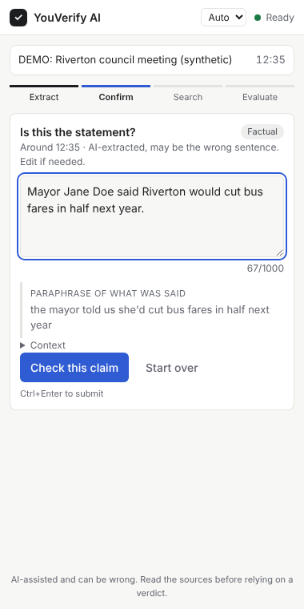
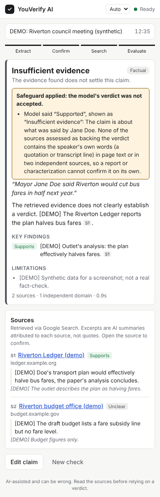
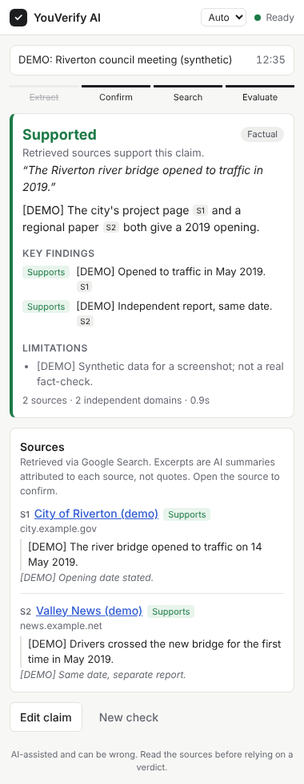
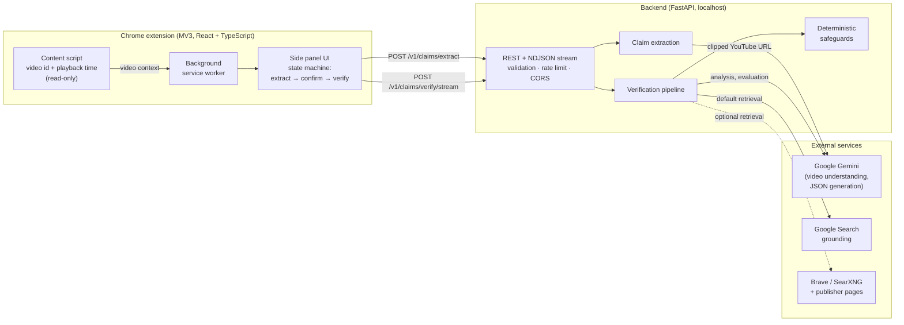
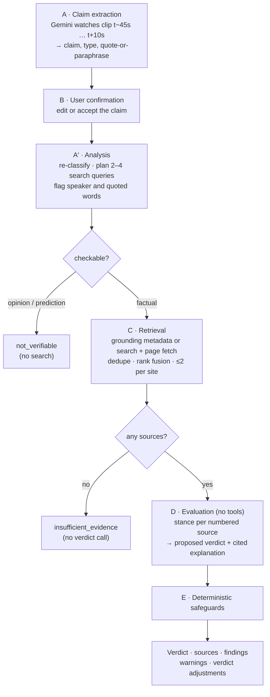

<div align="center">

# YouVerify AI

**Fact-check what someone says in a YouTube video at the moment they say it, with sources you can open and an honest "not enough evidence" when that is the answer.**

[](https://github.com/Apostal322/WHATTHESAY-/actions/workflows/ci.yml)


[](LICENSE)


</div>

YouVerify AI is a Chrome side-panel extension with a Python backend. While a video plays, you
click **Verify claim**. The app:

1. finds the statement spoken just before that moment;
2. lets you confirm or correct it;
3. retrieves evidence;
4. returns a verdict with numbered, clickable sources.

Every verdict the model proposes passes through deterministic safeguards. A safeguard can
overrule the model when the retrieved evidence does not justify its confidence.

<table>
  <tr>
    <td align="center"></td>
    <td align="center"></td>
    <td align="center"></td>
  </tr>
  <tr>
    <td align="center"><b>1. Confirm the claim</b><br><sub>extracted near 12:35, editable</sub></td>
    <td align="center"><b>2. A safeguard at work</b><br><sub>the model said "Supported" from an outlet's summary; the backend refused it</sub></td>
    <td align="center"><b>3. A backed verdict</b><br><sub>two independent sources</sub></td>
  </tr>
</table>

> [!NOTE]
> **These screenshots are simulated demonstrations with synthetic data, not real fact-checks.** They show the real built extension and the real
> backend (API, streaming, guardrails), but the model's answers come from a scripted fake model
> ([`backend/tests/demo_server.py`](backend/tests/demo_server.py)). The town, the mayor and the
> `example.*` sources are invented, and every model-written line is tagged `[DEMO]`. In image 2,
> the safeguard is the real attribution check reacting to the scripted model verdict.
> [How to regenerate them](docs/development.md#regenerating-the-readme-screenshots).

---

## Contents

[Problem](#the-problem) · [Solution](#the-solution) · [Features](#key-features) ·
[Architecture](#architecture) · [ML / RAG pipeline](#the-ml--rag-pipeline) · [Tech stack](#technology-stack) ·
[Status](#project-status-what-is-real) · [Installation](#installation) · [Usage](#usage) ·
[Testing](#testing-and-quality) · [Evaluation](#evaluation-methodology) · [Security](#security-and-privacy) ·
[Limitations](#known-limitations) · [Roadmap](#roadmap) · [Docs](#documentation)

## The problem

Claims made in videos are hard to check. You have to pause, transcribe the sentence, search, open
several pages and judge whether they really say what you hoped. LLM-based fact-checkers make
this faster, but they bring their own failure modes:

- **Invented or unrelated sources.** The model cites a URL it never retrieved, or one that does
  not say what it claims.
- **Overconfidence.** The model gives a confident verdict when the evidence is thin, one-sided,
  or several copies of the same wire story.
- **Misattribution.** A journalist's *summary* of what someone meant is treated as the person's
  *own words*.
- **Hidden uncertainty.** The model reports a number like "87% confident" that is not calibrated.

## The solution

YouVerify treats the language model as a capable but untrusted component and puts checkable rules
around it:

- **Only retrieved sources can be cited.** Sources are built from grounding metadata or search
  results, never from model text. Unknown source IDs and citations are dropped.
- **Verdicts need backing.** `supported` / `contradicted` / `mixed` require sources that the
  evaluation actually assessed in that direction. Otherwise the verdict becomes
  `insufficient_evidence`.
- **What someone said is a separate kind of claim.** "X said Y" needs X's own words (a quotation
  or a transcript line), and any quoted wording must appear verbatim in a source.
- **Safeguards are recorded, not hidden.** When the backend overrules the model, the response
  carries a `verdict_adjustments` entry (rule, from, to, reason). The UI shows it apart from
  advisory warnings.
- **No fake confidence.** There are five verdict labels and no confidence score.

## Key features

| | |
|---|---|
| 🎯 **Timestamp-based claim extraction** | Gemini watches only a clip around the click (default 45 s before, 10 s after; low frame rate), not the whole video. |
| ✍️ **Human in the loop** | The extracted claim is always shown for editing, labelled *exact quote* or *paraphrase*, before anything is verified. |
| 🔎 **Two retrieval modes** | **Google Search grounding** (default; needs only a Gemini key), or **search + page fetch** (Brave or a private SearXNG). In search mode, verbatim passages are taken from fetched pages. |
| ⚖️ **Per-source evaluation** | Each numbered source is assessed (`supports` / `contradicts` / `partially_supports` / `unclear` / `irrelevant`) before a verdict is proposed. |
| 🛡️ **Deterministic safeguards** | Backing-source check, attribution and exact-quote checks, quotation guard, independence count that treats syndicated copies as one origin, and citation integrity. |
| 📡 **Streaming progress** | NDJSON stream of the backend's real stages: analysing, searching, evaluating. |
| 🌍 **English and Russian** | Extraction, analysis and reported-speech detection for both languages. |
| 🧪 **Evaluation tooling** | Reference records, offline evidence fixtures, proposition-level scoring, chronology checks, and a "false confident verdict" metric. |
| 🔐 **Security-first** | Keys stay on the backend; SSRF-guarded fetching with DNS pinning; prompt-injection delimiters; minimal extension permissions; secret scanner in CI. |

## Architecture



**Design boundaries**

- **Adapter boundary:** business logic depends on an `LLMClient` protocol. `GeminiClient` is the
  only module that imports the Gemini SDK, so tests use deterministic fakes.
- **Retriever protocol:** `GeminiGroundingRetriever`, `SearchRetriever` and the offline
  `FixtureRetriever` all return the same `EvidenceSource` records. Each record is labelled with
  its origin: `grounding_summary`, `search_snippet` or `page_text`.
- **Model output is untrusted:** it is schema-constrained at generation, re-validated with
  Pydantic, length-clipped and post-checked.
- **No database:** an in-memory TTL cache behind a `get`/`set` interface, which Redis can
  replace without touching the services.

## The ML / RAG pipeline



| Stage | What happens | Code |
|---|---|---|
| **A. Extraction** | Gemini receives the public YouTube URL with clip offsets and a low frame rate and media resolution. It returns a structured `ExtractionOutput`: the claim, its type (`factual` / `prediction` / `opinion` / `ambiguous` / `non_verifiable`), context, and what was said, flagged as exact quote or paraphrase. | `services/extraction.py` |
| **B. Confirmation** | Timestamp alignment is best-effort, so a person always confirms or edits the claim. | `components/ClaimEditor.tsx` |
| **A′. Analysis** | Re-classifies the (possibly edited) claim and plans search queries. It also records whom the claim attributes words to and any exact words quoted. Opinions and predictions stop here. | `services/verification.py`, `prompts.py` |
| **C. Retrieval** | *Grounding mode:* sources come **only** from Gemini's `grounding_chunks`, with excerpts from `grounding_supports`; the model cannot add a URL. *Search mode:* Brave/SearXNG with failover and a circuit breaker; canonical-URL dedupe, rank fusion across queries, a lexical relevance filter, and at most two results per site. Pages are fetched SSRF-safely and verbatim passages of up to 400 characters are extracted and re-checked against the page. | `services/retrieval.py`, `search.py`, `evidence.py`, `fetch.py`, `citations.py` |
| **D. Evaluation** | A separate tool-less Gemini call sees only the numbered sources and where each excerpt came from. It assesses each source, then proposes a verdict with `[S#]` citations. | `prompts.py`, `verification.py` |
| **E. Safeguards** | Deterministic Python. It can **change** the verdict (recorded in `verdict_adjustments`) or **warn** (recorded in `guardrail_notes`). See the table below. | `verification.py`, `attribution.py`, `evidence.py` |

**Safeguards (they change the verdict)**

| Rule | Trigger | Result |
|---|---|---|
| `verdict_without_backing_source` | `supported` / `contradicted` / `mixed` with no source assessed in that direction | `insufficient_evidence` |
| `attribution_without_direct_evidence` | A claim about what someone said ("X said…", "X заявил…", or flagged by the analysis) without the speaker's own words in a backing source. Own words means a quotation in an excerpt that names them, or a transcript line under their label, found in page text or in two independent sources. A moderator restating the claim, or a quotation from someone else, does not count. | `insufficient_evidence` |
| `exact_quote_not_confirmed` | `supported` for a claim that quotes words, when those words are not verbatim in a supporting source | `insufficient_evidence` |

**Warnings (advisory notes, verdict unchanged):** verdict resting on a single origin; quoted
words in the explanation not found in the cited page text; dropped unknown citations;
syndicated near-copies counted once.

Verdict labels: `supported`, `contradicted`, `mixed`, `insufficient_evidence`, `not_verifiable`.

## Technology stack

| Layer | Technology |
|---|---|
| LLM | Google Gemini via `google-genai` (video understanding, JSON-schema output, Google Search grounding); optional fallback model on HTTP 503 |
| Backend | Python 3.11+, FastAPI, Uvicorn, Pydantic v2, pydantic-settings, httpx |
| Retrieval | Gemini grounding; Brave Search API; SearXNG (private instance); SSRF-guarded page fetcher with DNS pinning |
| Extension | Chrome Manifest V3 (side panel, service worker, content script), React 19, TypeScript, Vite |
| Testing | pytest + pytest-asyncio, Vitest + Testing Library + jsdom, Playwright-driven Chromium E2E |
| Quality | Ruff (lint + format), mypy (strict), `tsc --noEmit`, secret scanner, GitHub Actions CI |

## Project status: what is real

This is a **research prototype**, not a product. Status words: *verified live* (run against the
real provider), *verified with mocks* (automated tests with fake models or fixture pages),
*blocked* (reason given).

| Capability | Status |
|---|---|
| Backend API, pipeline, safeguards, error handling | ✅ Verified with mocks: **356** backend tests (incl. property-based and real-server cancellation tests); Ruff, mypy (strict) clean; CI green |
| Chrome extension UI and messaging | ✅ Verified with mocks: **46** component, unit and randomized state-machine tests; Chromium smoke test of the real built extension (incl. a service-worker restart) in CI |
| Video claim extraction with Gemini | ✅ **Verified live**: 5 successful extractions across two Gemini models. Outputs are **not yet labelled**, so no accuracy is claimed |
| Clip offsets reduce processed video | ✅ **Verified live**: media tokens scaled with the window length in 3/3 paired runs |
| End-to-end live verdict with real sources | ⛔ **Blocked**: free-tier Gemini returned 503 overload and Google Search grounding 429 quota in every attempt (latest 2026-10-15). No live verdict has been produced yet |
| Search mode (Brave / SearXNG + page fetch) | 🧪 Verified with mocks; not run live (no Brave key, and the dev sandbox blocks publisher sites) |
| Accuracy | ⚠️ **Not measured.** It needs human-labelled cases; see [Evaluation](#evaluation-methodology) |
| Public deployment | ❌ Not ready: single-user local backend, no auth. See the blockers in [security & privacy](docs/security-privacy.md) |

Full detail, including every live attempt and its failure: [live validation report](docs/live-validation-report.md).

## Installation

**Requirements:** Python 3.11+, Node.js 22.12+, Google Chrome 116+, and a
[Gemini API key](https://aistudio.google.com/apikey). The key is only needed for live runs: the
tests and the demo backend need none.

### 1. Configure

```bash
cp .env.example .env        # Windows: Copy-Item .env.example .env
```

Set `GEMINI_API_KEY` in `.env`. Never commit it: `.env` is git-ignored, and
`python scripts/scan_secrets.py --staged` checks a commit before you make it. On Windows, the
[local validation guide](docs/windows-local-validation.md) shows masked key entry that keeps the
key out of the PowerShell history.

| Setting | Default | Purpose |
|---|---|---|
| `YOUVERIFY_EXTRACTION_MODEL` / `YOUVERIFY_VERIFICATION_MODEL` | `gemini-3.8-flash` | Check what your key can use with `python scripts/list_models.py` |
| `YOUVERIFY_FALLBACK_MODEL` | `gemini-3.6-flash` | Tried once, only on 503 overload |
| `YOUVERIFY_RETRIEVAL_BACKEND` | `gemini_grounding` | Or `search` (Brave / SearXNG + page fetch) |
| `YOUVERIFY_GEMINI_DAILY_CALL_LIMIT` | unset | Hard daily cap on model requests per process |
| `YOUVERIFY_ALLOWED_ORIGIN_REGEX` | any extension | Restrict CORS to your extension ID |

All settings are documented in [`.env.example`](.env.example).

### 2. Backend

```bash
cd backend
python -m venv .venv
source .venv/bin/activate          # Windows: .\.venv\Scripts\Activate.ps1
pip install -e ".[dev]"
uvicorn app.main:app --host 127.0.0.1 --port 8000
```

Open <http://127.0.0.1:8000/health>. `"gemini_configured": true` means the key was loaded.
Interactive API docs are at `/docs`.

### 3. Extension

```bash
cd extension
npm ci
npm run build                      # → extension/dist
```

In Chrome, open `chrome://extensions`, enable **Developer mode**, click **Load unpacked**, and
select `extension/dist`. Pin **YouVerify AI**; clicking it opens the side panel. Then set
`YOUVERIFY_ALLOWED_ORIGIN_REGEX=^chrome-extension://<your-extension-id>$` in `.env` and restart
the backend.

## Usage

1. Open a public `youtube.com/watch` video with speech (English or Russian) and open the side panel.
2. Just after a factual statement, click **Verify claim at mm:ss**. The video keeps playing.
3. Check the proposed claim and its *quote* / *paraphrase* label, edit it if needed, then click
   **Check this claim** (Ctrl+Enter).
4. Read the verdict, any **safeguard** notice, the limitations, and the sources. Open the sources:
   excerpts in grounding mode are AI summaries attributed to a page, not quotations.

You can also **type a claim manually**, with no video. To check one claim from the command line:

```bash
python scripts/verify_claim.py --claim "The Eiffel Tower was completed in 1889." --id eiffel
```

**Try the UI without a key.** Run the scripted demo backend, then load the extension as above:

```bash
cd backend && python -m tests.demo_server     # synthetic [DEMO] data, fake model
```

## Testing and quality

```bash
# backend/
pytest                                        # 356 tests · no network · no key
ruff check . ../scripts && ruff format --check . ../scripts
mypy app                                      # strict
python ../scripts/scan_secrets.py             # also a CI step

# extension/
npm test                                      # 46 tests (Vitest + Testing Library)
npm run typecheck && npm run build
npm run e2e                                   # real extension in headless Chromium; needs `python -m tests.e2e_server`
```

What the tests cover:

- **API and pipeline:** contracts, streaming, error mapping and provider diagnostics.
- **Guardrails and safeguards:** backing sources, attribution and exact quotes, independence,
  citation integrity.
- **Retrieval:** ranking, failover, paid-search limits, SSRF and DNS-pinning, verbatim passage
  checks.
- **Security:** prompt-injection escaping and secret redaction.
- **Evaluation:** reference-record validators and the scoring code.

Safeguard regression tests were written to fail on the code before the fix and pass after it
(see [report §7g](docs/live-validation-report.md#7g-attribution-safeguard-2026-10-14-no-api-calls)).

## Evaluation methodology

Accuracy is **not reported** until it can be measured honestly:

- **Primary metric: the false confident verdict rate.** A confident `supported` /
  `contradicted` that the reference answer key rejects counts against the system. An
  `insufficient_evidence` counts as a miss, which is less harmful than a confident error.
- **Proposition-level scoring.** A compound claim is split into independently testable parts:
  attribution, chronology, characterization and legal effect. Each part is verified and scored
  on its own, because a system can be right about the facts and still wrong about who said what.
- **Provenance is explicit.** Reference records keep four things apart: who located a source,
  whether the app inspected it, whether a human approved it, and what an AI inferred. The schema
  stops an AI reviewer from marking a record `human_verified`.
- **Offline evidence fixtures.** Captured verbatim excerpts replay through the real pipeline, so
  the evaluator can be tested without live search.

The first reference case (a 2024 US presidential debate claim, five propositions) is
*AI-reviewed*, so its scores are provisional. See the [evaluation protocol](docs/evaluation.md)
and the [reference record](eval/reference/en-debate-1200.md).

## Security and privacy

- API keys live only in the backend environment; the extension holds no secrets.
- The extension asks for `sidePanel` plus host access to `www.youtube.com` and the local backend.
  It has no `tabs`, `storage`, `<all_urls>` or `webRequest`, and its content script is read-only.
- User-supplied URLs are never fetched. YouTube URLs are reduced to a validated video ID.
  Search-mode page fetching is SSRF-guarded: public hosts only, DNS pinning, re-validated
  redirects, size and time limits.
- Untrusted text from videos, claims and pages is delimited and escaped in prompts, and the
  output is schema-validated.
- Rate limiting, body-size limits and paid-search spend caps are in place.

Details and threat model: [docs/security-privacy.md](docs/security-privacy.md).

## Known limitations

- **Timestamp alignment is best-effort.** The model may pick a neighbouring sentence, which is
  why confirmation is mandatory. "Exact quote" is the model's own claim.
- **Grounding excerpts are summaries, not page text.** In the default mode the evaluator judges
  Google's attributed summaries, not full pages.
- **Per-source stances are model judgements.** Safeguards enforce consistency, not truth.
- **The attribution check is heuristic.** It detects quotation marks and speaker labels, not
  meaning, and it errs toward `insufficient_evidence`
  ([details](docs/live-validation-report.md#7g-attribution-safeguard-2026-10-14-no-api-calls)).
- **Scope:** public `youtube.com/watch` videos only; no Shorts, live streams, private or
  unlisted videos.
- **Single-user local backend:** no auth, and the cache and rate limits are in memory.

## Roadmap

- [ ] Produce the first live end-to-end verdict on a paid or reset quota, and capture the debate
      fixture's evidence on a networked machine
- [ ] Build a human-labelled set of 30–50 EN/RU video moments, then report the false confident
      rate, extraction accuracy and F1
- [ ] Use official caption tracks, where available, for exact quotes and alignment
- [ ] Add NLI-based entailment between quotes and claims, to make the attribution check semantic
- [ ] Add a Redis cache, per-user quotas and auth for a shared deployment

## Project structure

```
backend/        FastAPI app: api/, core/, models/, services/ (pipeline), evaluation/
backend/tests/  356 offline tests; scripted servers for E2E and screenshots
extension/      Chrome MV3 extension: content/, background/, sidepanel/, components/, shared/
scripts/        CLI tools: claim PoC, live validation, verify_claim, evidence capture, secret scan
eval/           reference answer keys, offline evidence fixtures, run artifacts
docs/           architecture, API, development, evaluation, security, validation reports
```

## Documentation

| Document | Contents |
|---|---|
| [API reference](docs/api.md) | Endpoints, request and response schemas, error codes |
| [Development guide](docs/development.md) | Commands, repository layout, manual test plan, troubleshooting provider errors |
| [Retrieval architecture](docs/retrieval-architecture.md) | Retrievers, search providers, independence, outage semantics, paid-search policy |
| [Evaluation protocol](docs/evaluation.md) | Datasets, metrics, reference records, offline fixtures |
| [Quality audit](docs/quality/README.md) | Quality matrix (PASS / FAIL / BLOCKED per requirement), defect register, release readiness, DevOps handoff, store checklist |
| [Live validation report](docs/live-validation-report.md) | Every live run, failure diagnosis, audit findings, the attribution safeguard |
| [Feasibility study](docs/feasibility.md) | Timestamp-based extraction with Gemini: risks and measurements |
| [Security and privacy](docs/security-privacy.md) | Data flow, threat model, public-beta blockers |
| [Windows local validation](docs/windows-local-validation.md) | Step-by-step Windows setup, safe key entry, evidence capture |

## License

Released under the [MIT License](LICENSE).
