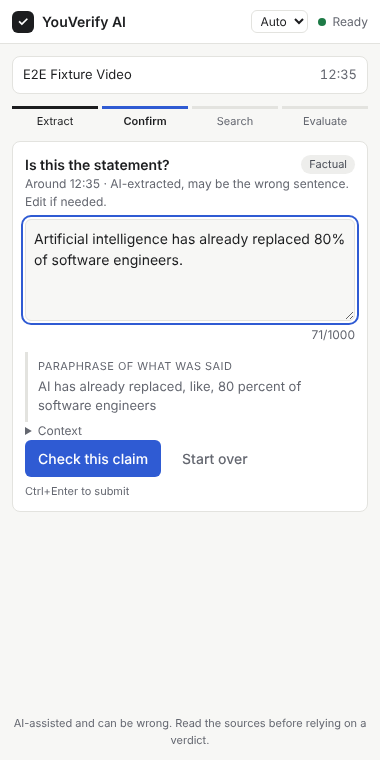
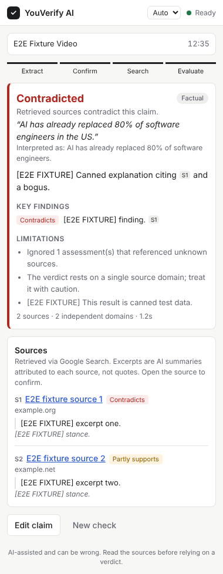

# YouVerify AI

Fact-check a statement from the YouTube video you are watching without leaving the
video. Press **Verify claim** in Chrome's side panel. YouVerify finds the statement
near the current timestamp, lets you confirm or edit it, searches for evidence, and
returns an evidence-based verdict with clickable sources. When the evidence does not
settle the claim, it says so.

<p>
  
  
</p>

<sub>Screenshots are from the automated E2E run, which uses canned fixture data, not a real verdict.</sub>

## Contents

- [How it works](#how-it-works)
- [Project status](#project-status)
- [Setup (Windows)](#setup-windows) · [macOS / Linux](#setup-macos--linux)
- [Testing the full user flow](#testing-the-full-user-flow)
- [API](#api)
- [Development](#development)
- [Diagnosing provider errors](#diagnosing-provider-errors)
- [Known limitations](#known-limitations)
- [Future ML improvements](#future-ml-improvements)
- Docs: [Windows local validation](docs/windows-local-validation.md) · [live validation report](docs/live-validation-report.md) · [evidence retrieval architecture](docs/retrieval-architecture.md) · [feasibility report](docs/feasibility.md) · [evaluation protocol](docs/evaluation.md) · [security & privacy](docs/security-privacy.md)

## How it works

```
 Chrome                                              Backend (FastAPI, localhost)              Google
┌─────────────────────────────────────┐            ┌──────────────────────────────────────┐
│ content script (youtube.com/watch)  │            │ POST /v1/claims/extract               │
│  reads video id + currentTime       │            │  validate id → canonical URL          │   Gemini
│            ▲ GET_VIDEO_CONTEXT      │            │  clip [t-45s, t+10s], fps 0.5, low res ├──► video understanding
│ background service worker           │            │  → structured ExtractionOutput        │
│            ▲ GET_ACTIVE_VIDEO_CTX   │   HTTP     │                                      │
│ React side panel ───────────────────┼───────────►│ POST /v1/claims/verify/stream (NDJSON)│
│  idle → extracting → claim_ready    │            │  A  analyze: type + search queries    ├──► Gemini (JSON)
│  (user edits) → searching →         │◄───────────┤  C  grounded search                   ├──► Gemini + Google Search
│  evaluating → complete | error      │  stages +  │     sources ONLY from grounding meta  │
└─────────────────────────────────────┘  result    │  D  evaluate evidence (no tools)      ├──► Gemini (JSON)
                                                   │  F  guardrails: drop unknown ids,     │
                                                   │     downgrade unsupported verdicts    │
                                                   └──────────────────────────────────────┘
```

**Pipeline**

| Step | What happens | Where |
|---|---|---|
| A. Claim extraction | Gemini watches only a clip around the click. It returns the claim, its type (`factual` / `prediction` / `opinion` / `ambiguous` / `non_verifiable`), context, and what was said, flagged as exact quote or paraphrase. | `services/extraction.py` |
| B. Confirmation | The claim is always shown for editing before verification, because timestamp alignment is not guaranteed. | `ClaimEditor.tsx` |
| A′. Analysis | Re-classifies the (possibly edited) claim and plans 2–4 search queries. Opinions and predictions stop here with `not_verifiable`. | `services/verification.py` |
| C. Retrieval | Gemini with **Google Search grounding**. Citable sources are built **only** from `grounding_chunks`, with excerpts from `grounding_supports`. The model cannot add a URL. | `services/citations.py` |
| D–E. Evaluation | A separate tool-less call assesses each numbered source (`supports` / `contradicts` / `partially_supports` / `irrelevant`) and proposes a verdict using only those sources. | `prompts.py` |
| F. Integrity | Deterministic Python: drops assessments and citations with unknown IDs, downgrades a verdict to `insufficient_evidence` if no source was assessed as backing it, flags single-domain verdicts, merges duplicate URLs, counts independent domains. No sources means `insufficient_evidence` without any verdict call. | `verification.py`, `citations.py` |

Verdicts: `supported`, `contradicted`, `mixed`, `insufficient_evidence`, `not_verifiable`.
No numerical confidence is shown, because model self-reported confidence is not calibrated.

**Design choices**
- **Adapter boundary.** Business logic depends on an `LLMClient` protocol. `GeminiClient`
  is the only module that imports the SDK, and tests use a deterministic fake.
- **Model output is untrusted.** It is schema-constrained at generation time, re-validated
  with Pydantic, length-clipped and post-checked.
- **Streaming progress.** The UI shows the backend's actual stages, not a timer.
- **No database.** A small in-memory TTL cache with a `get`/`set` interface sits behind
  the services, so Redis can replace it without touching them.

## Project status

Status words: **verified live** (ran against the real provider), **verified with mocks** (automated
tests with fake providers or fixture pages), **implemented, not tested live**, **blocked** (reason
given). Last updated 2026-10-14.

| Capability | Status |
|---|---|
| Backend API, pipeline, guardrails, error handling | Verified with mocks: 273 backend tests (ruff, format, mypy clean) |
| Chrome extension (MV3 side panel, content script, background) | Verified with mocks: 39 component/unit tests; builds to `extension/dist`. Mocked browser E2E (`npm run e2e`, fixture YouTube page, scripted model) passes |
| Video claim extraction (Gemini, clipped YouTube window) | **Verified live**: 4/6 cases on `gemini-3.8-flash` (2026-10-13) and 1 case on `gemini-3.6-flash` (2026-10-14, 9.7 s). Extractions are **unlabelled**: no accuracy is claimed, and the model's "exact quote" flag and speaker are unverified |
| Clip offsets reduce processed video | **Verified live** on `gemini-3.8-flash`: media tokens scaled 2.50× for a 2.50× window in 3/3 paired runs |
| Claim analysis (type, queries) | **Verified live** once (`gemini-3.6-flash`, 2026-10-14); output not retained (fixed since: see report §7c) |
| Grounded verification (verdict with sources) | **Blocked**: no completed live verdict yet. Gemini models returned 503 (overload) intermittently; Google Search grounding returned 429 quota on this free-tier key. See [report](docs/live-validation-report.md) §7c |
| Brave / SearXNG search, page quoting, citation checks, independence | Verified with mocks. **Blocked live**: no Brave key, and the dev sandbox denies search and publisher sites. See [architecture](docs/retrieval-architecture.md) |
| Model fallback on 503; per-step model recording | Verified with mocks; fallback **verified live** once (3.8 → 3.6 served the extraction) |
| Real youtube.com page in Chrome | **Blocked**: YouTube is denied in the dev sandbox. Script: `npm run e2e:live` |
| Accuracy (extraction, verdicts) | **Not measured**: no human-reviewed labels yet ([evaluation protocol](docs/evaluation.md)). One AI-reviewed reference record exists (`eval/reference/en-debate-1200`, five propositions); scores against it are provisional and never reported as accuracy |
| Offline evidence fixture + proposition-level runs | Implemented and verified with mocks (synthetic pages): capture, offline retriever, quotation check, chronology, per-proposition scoring. The real fixture (`eval/fixtures/en-debate-1200`) has **no captured excerpts yet**: every source host is blocked from the dev sandbox. Capture runs locally: [Windows guide](docs/windows-local-validation.md) §5 |
| Quoted words vs. sources | Verified with mocks: quotations in the explanation and findings that are not verbatim in cited page text are flagged in `guardrail_notes` |
| Public deployment | Not ready: see the public-beta blockers in [security & privacy](docs/security-privacy.md) and report §7 (NO-GO) |

## Setup (Windows)

Full step-by-step guide, including a network reachability check, safe key handling and the
offline evidence fixture: [docs/windows-local-validation.md](docs/windows-local-validation.md).

**Requirements:** Windows 10/11, [Python 3.11+](https://www.python.org/downloads/),
[Node.js 22.12+](https://nodejs.org/) (LTS), Google Chrome 116+, and a
[Gemini API key](https://aistudio.google.com/apikey).

PowerShell, from the repository root:

```powershell
# 1. Configuration
Copy-Item .env.example .env
notepad .env                      # set GEMINI_API_KEY=...

# 2. Backend
cd backend
py -3.11 -m venv .venv            # or: python -m venv .venv
.\.venv\Scripts\Activate.ps1      # if blocked: Set-ExecutionPolicy -Scope CurrentUser RemoteSigned
pip install -e ".[dev]"
python ..\scripts\list_models.py  # check which models your key can use; set YOUVERIFY_*_MODEL in .env if needed
uvicorn app.main:app --host 127.0.0.1 --port 8000
```

Check it at <http://127.0.0.1:8000/health>. `"gemini_configured": true` means the key was loaded.

In a **second** PowerShell window:

```powershell
# 3. Extension
cd extension
npm ci
npm run build                     # produces extension\dist
```

**4. Load in Chrome**
1. Open `chrome://extensions` and turn on **Developer mode** (top right).
2. Click **Load unpacked** and select the `extension\dist` folder.
3. Pin **YouVerify AI** from the puzzle-piece menu. Clicking its icon opens the side panel.
4. Recommended: copy the extension ID shown on the card and restrict the backend to it
   in `.env`, then restart the backend:
   `YOUVERIFY_ALLOWED_ORIGIN_REGEX=^chrome-extension://<your-id>$`

After rebuilding, click the reload icon on the extension card. Reload any YouTube tabs
that were open before the extension was installed.

## Setup (macOS / Linux)

```bash
cp .env.example .env && $EDITOR .env
cd backend && python3 -m venv .venv && source .venv/bin/activate && pip install -e ".[dev]"
uvicorn app.main:app --host 127.0.0.1 --port 8000
# new terminal
cd extension && npm ci && npm run build   # then load extension/dist as above
```

## Testing the full user flow

0. **Run the live validation harness** (preflight, extraction against your
   human-verified moments, 20 s vs 50 s clipping, verification, cited-page screening):
   ```bash
   cp eval/live_cases.template.jsonl eval/live_cases.jsonl   # fill in real moments
   python scripts/live_validation.py eval/live_cases.jsonl --fetch-sources
   ```
   See [docs/live-validation-report.md](docs/live-validation-report.md).
1. **Or validate extraction on its own** (the riskiest part):
   ```bash
   python scripts/poc_extract_claim.py --url "https://www.youtube.com/watch?v=VIDEO_ID" --timestamp 755
   python scripts/poc_extract_claim.py --url "https://www.youtube.com/watch?v=VIDEO_ID" --timestamp 755 --probe-clipping
   ```
   The first command prints the extracted claim JSON with latency and token usage.
   The second checks whether Gemini honours clip offsets (see [feasibility](docs/feasibility.md)).
2. Open a public `youtube.com/watch` video with speech (English or Russian) and open the side panel.
   It shows the video title and current position.
3. Just after a factual statement, click **Verify claim at mm:ss**. The video keeps playing.
4. Check the proposed claim and its quote/paraphrase label. Edit it if the wrong sentence
   was picked, then click **Check this claim** (or press Ctrl+Enter).
5. Watch the stages (analyzing, searching, evaluating), then read the verdict, the
   limitations and the sources. Open a source to confirm it says what the excerpt claims.
6. Edge cases to try:
   - a Shorts page (blocked with a message)
   - an ad playing
   - a private or region-locked video (offers manual entry)
   - an opinion such as "this is the best phone ever" (should return `not_verifiable`)
   - **Or type a claim manually** on any page
   - backend stopped or started without a key (clear status and errors)

Without a key you can still exercise the UI end to end with the scripted fixture backend:

```bash
cd backend && python -m tests.e2e_server      # fake model, canned data; clearly labelled
cd extension && npm run build && npm run e2e  # headless Chromium smoke test
```
`npm run e2e` launches Chromium from `CHROMIUM_PATH`. On Windows, point it at Chrome:
`$env:CHROMIUM_PATH="C:\Program Files\Google\Chrome\Application\chrome.exe"`.

## API

Interactive docs: <http://127.0.0.1:8000/docs>. All errors look like
`{"error": {"code": "...", "message": "...", "retryable": bool}}`. The codes are
`invalid_input`, `video_unavailable`, `missing_credentials`, `model_not_found`,
`rate_limited`, `provider_rate_limited`, `provider_quota_exhausted`, `provider_timeout`, `provider_error`,
`retrieval_unavailable` (no evidence could be retrieved at all; not a verdict), `backend_misconfigured`,
`invalid_model_output` and `payload_too_large`.

```http
POST /v1/claims/extract
{"youtube_url": "https://www.youtube.com/watch?v=VIDEO_ID", "timestamp_sec": 755, "language": "auto"}
```
```json
{
  "status": "success",
  "video_id": "VIDEO_ID",
  "timestamp_sec": 755,
  "window": {"start_sec": 710, "end_sec": 765},
  "claim": "Artificial intelligence has already replaced 80% of software engineers.",
  "claim_type": "factual",
  "context": "…",
  "evidence_from_video": "AI has already replaced like 80 percent of software engineers",
  "is_exact_quote": false,
  "requires_user_confirmation": true,
  "language": "en",
  "reason": null,
  "model": "gemini-…",
  "latency_ms": 0,
  "cached": false,
  "usage": {"prompt_tokens": 0, "output_tokens": 0, "total_tokens": 0, "video_tokens": null, "audio_tokens": null, "estimated_cost_usd": null}
}
```
`status` is `no_claim_found` (with a `reason`) when nothing checkable was said.
The values above show the response shape, not a measured result.

```http
POST /v1/claims/verify          → VerifyResponse (JSON)
POST /v1/claims/verify/stream   → NDJSON: {"event":"stage","stage":"analyzing|searching|evaluating"} … {"event":"result","data":VerifyResponse}
{"claim": "…", "context": "…", "claim_type_hint": "factual", "video_id": "…", "timestamp_sec": 755, "language": "auto"}
```
`VerifyResponse` contains `claim`, `normalized_claim`, `claim_type`, `verdict`,
`explanation` (with `[S#]` citations), `key_findings`, `sources[]` (`id`, `title`, `url`,
`domain`, `retrieved_at`, `excerpts`, `stance`, `assessment_note`; `publisher` and
`published_date` are `null` unless known, never guessed), `limitations`,
`search_queries`, `independent_source_count`, `guardrail_notes` and `usage`.

## Development

```bash
# backend (from backend/)
pytest                    # 273 tests, no network, no key
ruff check . ../scripts && ruff format --check . ../scripts
mypy app                  # strict
python ../scripts/scan_secrets.py            # tracked files (CI); add --staged before a commit

# extension (from extension/)
npm test                  # vitest + Testing Library (39 tests)
npm run typecheck
npm run build
npm run e2e               # needs the build + a backend on :8000 (see above)
```

Repository layout:

```
backend/app/
  api/          routes (incl. NDJSON stream), dependency wiring
  core/         config, typed errors, JSON logging, TTL cache, rate limiter
  models/       API schemas, model-output schemas
  services/     youtube validation, Gemini adapter, prompts, extraction,
                verification + guardrails, citation integrity
  evaluation/   eval dataset schema and metrics; reference records, offline evidence
                fixtures, chronology, proposition-level runs
backend/tests/  unit, API and adapter tests; e2e_server.py fixture
extension/src/
  content/      YouTube video context (read-only)
  background/   side panel behavior, message broker
  sidepanel/    App, hooks, Chrome bridge, styles
  components/   ClaimEditor, VerdictCard, SourceList, …
  shared/       API client, state machine, types, formatting
scripts/        poc_extract_claim.py, live_validation.py, verify_claim.py, capture_evidence.py,
                run_fixture_case.py, list_models.py, run_eval.py, make_icons.py
eval/           dataset.example.jsonl, reference/ (answer keys), fixtures/ (offline evidence),
                factchecks/ (run artifacts); runs/ is git-ignored
docs/           feasibility, evaluation, security & privacy
```

## Diagnosing provider errors

Every provider failure is returned with a stable code. The backend logs (JSON) and the evaluation
artifacts also carry sanitized diagnostics: operation, model, HTTP status, provider status, quota id,
retry delay and the steps that completed before the failure. Diagnostics are never sent to the
extension.

| Code | Meaning | What to do |
|---|---|---|
| `provider_error` with HTTP 503 in the logs | The Gemini model is overloaded ("high demand") | Wait, or set `YOUVERIFY_FALLBACK_MODEL` (one fallback attempt per call, 503 only) |
| `provider_quota_exhausted` | The key's quota is used up: daily request cap, or a search-grounding quota | Do not retry in a loop. Wait for the reset (Google documents midnight Pacific for daily quotas) or use a key with more quota |
| `provider_rate_limited` | A short-window rate limit | Retry after a short wait |
| `retrieval_unavailable` | No evidence could be retrieved at all (search or page fetch outage). **Not a verdict** | Retry later; check search provider configuration and network |
| `backend_misconfigured` | e.g. paid search without a price or daily cap | Fix the `.env` settings named in the message |
| `missing_credentials` | `GEMINI_API_KEY` (or a search key) is not set | Configure it on the backend |

**Checking one claim without the extension (manual-claim mode):**

```bash
# typed claim (labelled "manual" in the artifact)
python scripts/verify_claim.py --claim "The Eiffel Tower was completed in 1889." --id eiffel
# or reuse a saved video extraction, with no new extraction call
python scripts/verify_claim.py --from-run eval/factchecks/<artifact>.json
```

This writes `eval/factchecks/<id>-<time>.json` plus a Markdown review sheet.

**A reference case, proposition by proposition, over offline evidence** (no search; 2 calls per
proposition; refuses to run until the fixture has captured excerpts):

```bash
python scripts/capture_evidence.py --check-only     # which hosts this network reaches (no API calls)
python scripts/capture_evidence.py                  # the app captures short verbatim excerpts
python scripts/run_fixture_case.py                  # dry run: plan and call count
python scripts/run_fixture_case.py --llm gemini --max-calls 10
```

The result is "live evaluation of offline evidence", never a live fact-check. A person fills in the
review section (quote and speaker checked, sources opened, verdict agrees). In the extension, use
**Type a claim manually**.

## Known limitations

- **Timestamp alignment is best-effort.** Gemini does not guarantee word-level
  transcription. The model may choose a neighbouring sentence, which is why
  confirmation is mandatory. "Exact quote" is a model self-report.
- **Clip offsets on YouTube URLs are unverified**, and if they are ignored cost
  scales with video length. Run `--probe-clipping`.
- Public `youtube.com/watch` videos only; no Shorts, live streams, private or unlisted videos.
  The Gemini free tier allows 8 h of YouTube video per day.
- **Excerpts are grounded summaries**, not verbatim page text: Google Search grounding
  attributes the research model's sentences to sources. The evaluator judges those
  summaries, not full pages, so open the sources.
- Source `publisher` and `published_date` are not available from grounding metadata,
  so they are left empty rather than guessed.
- The evaluator's per-source stances are themselves model judgements. Guardrails
  ensure consistency, not correctness.
- Single-user local backend: no auth, and in-memory cache and rate limiting.
- The default model ID (`gemini-3.8-flash`) could not be checked against the live API.
  Verify it with `scripts/list_models.py`.

## Future ML improvements

- **Measured evaluation:** build a labelled set of 100+ EN/RU video moments, track
  false-confident rate as the primary metric, and run A/B tests on prompts, windows and models.
- **Better claim localisation:** use official caption tracks where the creator provides
  them for exact quotes and alignment, plus a claim-detection model to rank candidate
  sentences in the window.
- **Read the sources:** fetch cited pages (with SSRF-safe allowlisting or Gemini's URL
  context tool) and extract verbatim supporting passages. Then add an NLI model to
  cross-check stances independently of the LLM.
- **Retrieval quality:** query rewriting per claim type, re-ranking, topic-aware
  source-quality priors, and detection of syndicated copies beyond URL dedupe.
- **Calibration:** once enough labelled data exists, learn when to abstain, and only then
  consider showing calibrated confidence.
- **Infrastructure:** Redis cache keyed by (video, window) and claim hash; persistent
  run logs for offline evaluation.
